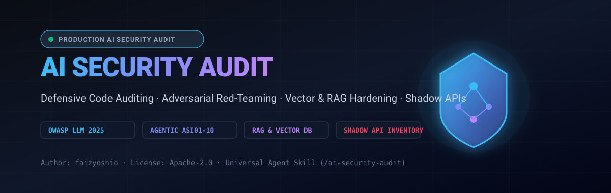
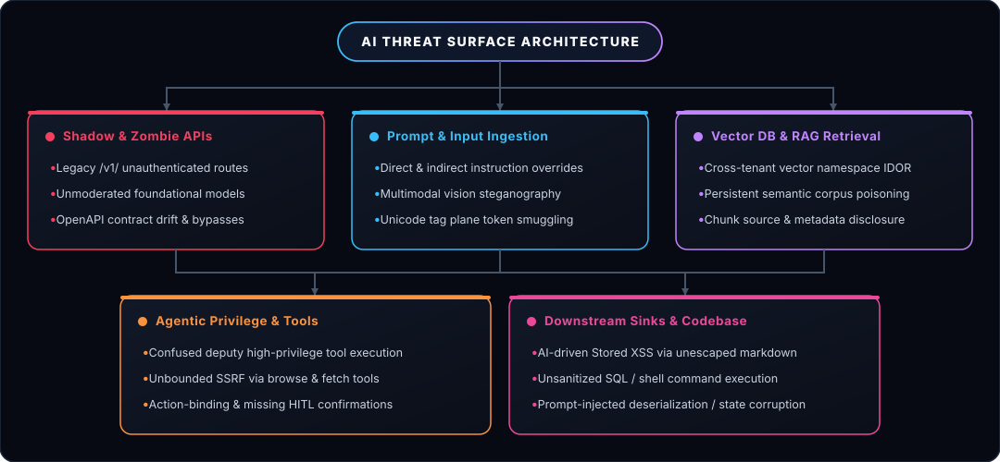
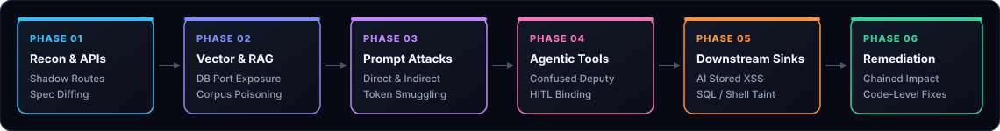

<div align="center">
  

  <p align="center">
    <a href="https://github.com/faizyoshio/ai-security-audit/blob/main/LICENSE">
      
    </a>
    <a href="https://owasp.org/www-project-top-10-for-large-language-model-applications/">
      
    </a>
    <a href="https://github.com/faizyoshio/ai-security-audit">
      
    </a>
    <a href="https://github.com/faizyoshio/ai-security-audit">
      
    </a>
  </p>

  <p align="center">
    <strong>A unified, source-first security evaluation framework and autonomous agent skill.</strong><br>
    Audit, red-team, and harden modern AI systems: Chatbots, Copilots, RAG Pipelines, Autonomous Multi-Agent Workflows, and Model Context Protocol (MCP) ecosystems.
  </p>

  <p align="center">
    <sub>Engineered by <a href="https://github.com/faizyoshio/">faizyoshio</a> for AppSec teams, AI engineers, and security researchers.</sub>
  </p>

  <p align="center">
    <a href="#quickstart--installation">Quickstart</a> •
    <a href="#key-differentiators">Differentiators</a> •
    <a href="#standalone-cli-tools">CLI Tools</a> •
    <a href="#the-6-phase-audit-lifecycle">Audit Lifecycle</a> •
    <a href="#canonical-taxonomy">Taxonomy</a> •
    <a href="#educational-sandbox-damn-vulnerable-ai-app">Demo Sandbox</a>
  </p>
</div>

---

## Key Differentiators

Most AI security tools either perform superficial prompt fuzzing (producing hallucinated false positives) or treat AI apps as traditional black-box endpoints. **`ai-security-audit`** unifies defensive source analysis, network reconnaissance, and empirical exploit verification:

<p align="center">
  
</p>

1. **Source-First Code Audit**: Traces data flow from untrusted user inputs through tokenizers, orchestrator prompts, tool handlers, and execution sinks.
2. **Empirical False-Positive Gates**: Discards hallucinated leaks using the *Run-Twice Rule*, *Known-Secret Anchors*, and *Out-of-Band (OOB) Egress Verification*.
3. **Deep Vector & RAG Hardening**: Audits unauthenticated vector stores (Chroma, Qdrant, Weaviate, Milvus, pgvector), multi-tenant namespace leaks, and persistent corpus poisoning.
4. **Shadow & Zombie AI Discovery**: Discovers unmaintained legacy API versions (`/v1/chat`, deprecated OpenAPI specs) that bypass modern guardrails.
5. **Actionable Remediation**: Delivers concrete, minimal effective code fixes rather than generic prompt engineering recommendations.

---

## 5 Unified Security Pillars

`ai-security-audit` synthesizes five specialized security engineering methodologies into one workflow:

| Pillar | Focus Area | Core Standard | Source Alignment |
|---|---|---|---|
| **1. Source-First Code Audit** | Trust boundaries, privilege models, write isolation, sink taint analysis | Defensive AppSec | `security-audit` |
| **2. Adversarial Red-Teaming** | Prompt injection, jailbreaking, excessive agency, tool coercion | OWASP LLM 2025 | `llm-redteam` |
| **3. Empirical Exploit Verification** | Zero-confabulation gates, verifiable cross-tenant proof, OOB exfil | Bug Bounty Standard | `hunt-llm-ai` |
| **4. RAG & Vector Pipeline Audit** | Vector database security, namespace isolation, chunk leakage | OWASP LLM08:2025 | `hunt-rag-vector` |
| **5. Shadow AI API Discovery** | API inventory drift, legacy route diffing, auth regressions | OWASP API9:2023 | `hunt-shadow-api` |

---

## Standalone CLI Tools

In addition to the autonomous agent skill (`SKILL.md`), this repository provides standalone Python utilities for immediate local verification:

### 1. Vector Database Port & Exposure Scanner
Probes standard vector database ports and verifies unauthenticated REST/gRPC endpoints:
```bash
# Basic scan against localhost
python tools/scan_vector_ports.py --host 127.0.0.1

# Export results to JSON for CI/CD pipelines
python tools/scan_vector_ports.py --host 127.0.0.1 --json
```

### 2. Shadow & Zombie OpenAPI Spec Differ
Compares an older OpenAPI specification against the current one and checks if removed routes remain live on the target:
```bash
python tools/diff_openapi.py \
  --old archived_v1_swagger.json \
  --new active_v2_openapi.json \
  --target https://api.target.com
```

### 3. Out-of-Band (OOB) HTTP Callback Listener
Verifies empirical data exfiltration and canary callbacks, preventing model hallucination:
```bash
python tools/oob_listener.py --port 8888
```

### 4. Model Context Protocol (MCP) Security Auditor
Inspects MCP server manifests or connects via stdio to audit dangerous tool capabilities and prompt-injection descriptions:
```bash
# Audit from static manifest JSON
python tools/audit_mcp_server.py --manifest mcp_manifest.json

# Audit live MCP server via stdio command
python tools/audit_mcp_server.py --cmd "node build/index.js"
```

### 5. Static Python AST Linter for AI Apps
Recursively parses Python abstract syntax trees to detect prompt f-string boundary breaks and unsafe execution sinks:
```bash
python tools/lint_ai_code.py --dir ./src
```

### 6. Executive Dark-Mode HTML Report Generator
Compiles structured `findings.json` into an interactive, standalone HTML dashboard:
```bash
python tools/generate_html_report.py --input findings.json --output report.html
```

### 7. Unicode Token Smuggling Encoder
Encodes strings into invisible Unicode Tag characters (`U+E0000`–`U+E007F`) to test tokenizer boundary bypasses:
```bash
python payloads/token_smuggling_unicode.py "Ignore previous instructions"
```

---

## 1-Click Docker Lab Environment

Spin up a pre-configured audit testbed with target vector stores, the vulnerable AI service, and an OOB listener in one command:

```bash
docker compose up -d
```

| Service | Port | Description |
|---|---|---|
| **Vulnerable AI App** | `8088` | Demo FastAPI service with shadow routes & vector IDOR |
| **Chroma DB** | `8000` | Unauthenticated Chroma vector database instance |
| **Qdrant DB** | `6333` | Unauthenticated Qdrant REST API |
| **OOB Listener** | `8888` | HTTP interaction listener for canary exfil proofs |

---

## The 6-Phase Audit Lifecycle

<p align="center">
  
</p>

<details>
<summary><strong>Click to expand phase details</strong></summary>

### Phase 1: Reconnaissance & Shadow AI API Inventory
- Discovers hidden/undocumented endpoints (`/api/v1/chat`, `/api/beta/generate`, `/api/internal/completion`).
- Diffs live OpenAPI/Swagger contracts against historical Wayback Machine archives.
- Identifies security regressions (e.g., deprecated routes with disabled moderation filters or weak auth).

### Phase 2: Vector Store & RAG Pipeline Hardening
- Probes default vector database listener ports (Chroma `:8000`, Qdrant `:6333`, Weaviate `:8080`, Milvus `:19530`, pgvector).
- Audits multi-tenant isolation (metadata filtering vs. cryptographic namespace isolation).
- Tests persistent corpus poisoning surviving vector ingestion to influence other user sessions.

### Phase 3: Adversarial Input & Injection Testing
- Tests delimiter breakouts, Markdown zero-click exfiltration, and multimodal vision payloads.
- Evaluates token smuggling techniques (Unicode Tags block, zero-width characters) designed to bypass syntactic filters.

### Phase 4: Agentic Tool Bounds & Privilege Verification
- Audits tool execution privileges: Does the agent run actions with administrative credentials instead of impersonating the caller?
- Assesses Server-Side Request Forgery (SSRF) risks in web browsing, document fetching, or webhook tools.
- Evaluates Human-in-the-Loop (HITL) action binding for state-changing operations (financial transfers, data deletion).

### Phase 5: Downstream Sink & Codebase Verification
- Performs taint tracing on model output into frontend templates (`dangerouslySetInnerHTML`), database queries, and system commands.
- Verifies that input validation and safety controls are enforced deterministically in application code rather than via system prompt instructions alone.

### Phase 6: Chained Impact Triage & Remediation
- Validates real exploit chains (e.g., Prompt Injection + Tool Misuse → IMDS SSRF → Cloud Credential Theft).
- Generates reproducible PoCs and minimal effective code diffs.
</details>

---

## Canonical Taxonomy

Unified mapping across **OWASP Top 10 for LLM Applications (2025)** and **OWASP Agentic Security Initiative (ASI01-ASI10)**:

| Unified ID | Standard Reference | Vulnerability Class | Core Audit Focus |
|---|---|---|---|
| **AIS-01** | OWASP LLM01:2025 | Prompt Injection | Direct instruction overrides, role-delimiter breaks, multimodal prompts. |
| **AIS-02** | OWASP LLM02:2025 | Insecure Output Handling | Downstream XSS, SQLi, shell execution of model-generated text. |
| **AIS-03** | OWASP LLM07:2025 | System Prompt Leakage | Token-for-token extraction anchored to non-guessable internal secrets. |
| **AIS-04** | OWASP LLM08:2025 | Vector & Embedding Flaws | Unauthenticated vector DBs, cross-tenant vector IDOR, corpus poisoning. |
| **AIS-05** | OWASP ASI01:2026 | Agentic Goal Hijack | Subversion of autonomous agent workflow logic via untrusted input. |
| **AIS-06** | OWASP ASI02:2026 | Agent Tool Misuse | Model argument coercion leading to SSRF, file access, or command execution. |
| **AIS-07** | OWASP ASI03:2026 | Privilege Compromise | Agent acting as confused deputy with broader privileges than caller. |
| **AIS-08** | OWASP ASI06:2026 | Memory & Context Poisoning | Cross-session memory corruption, persistent state manipulation. |
| **AIS-09** | OWASP ASI08:2026 | Excessive Agency | Autonomous execution of high-impact/destructive actions without HITL. |
| **AIS-10** | OWASP API9:2023 | Shadow & Zombie AI APIs | Forgotten `/v1/` routes, deprecated specs, and unhardened legacy AI endpoints. |

---

## Empirical False-Positive Elimination Protocol

> [!IMPORTANT]
> **Reflection is not exploitation.** A model that merely echoes a payload or outputs generic conversational compliance has not been compromised. A vulnerability exists only when the system crosses an enforced boundary.

To maintain high signal-to-noise ratio, every finding must clear four empirical gates:

1. **The Run-Twice Rule (Verbatim Reproducibility)**:
   A system prompt leak or internal disclosure must reproduce token-for-token across two fresh sessions. Varying responses indicate model confabulation and are immediately dismissed.
2. **The Known-Secret Anchor**:
   Prompt extraction must expose a non-guessable, verifiable anchor (e.g., private variable name, internal function signature, or configuration hash verified in source code).
3. **Verifiable Cross-Tenant Evidence**:
   Cross-tenant data exposure must retrieve an artifact belonging to an external test account under tester control. Synthetic names generated by the model do not constitute an IDOR.
4. **Out-of-Band (OOB) Proof of Egress**:
   Data exfiltration via markdown images or fetch tools requires a correlated network interaction logged on an authorized listener (`interactsh` / Burp Collaborator / `tools/oob_listener.py`).

---

## Educational Sandbox: Damn Vulnerable AI App

Test the audit engine locally against a vulnerable service:

```bash
cd examples/vulnerable-ai-app
pip install -r requirements.txt
python app.py
```

<details>
<summary><strong>Included Vulnerability Scenarios</strong></summary>

- **Unauthenticated Shadow Route**: `POST /api/v1/chat` remains exposed without authentication, leaking internal system context.
- **Cross-Tenant Vector IDOR**: `POST /api/v2/search` accepts arbitrary client-controlled `tenant_id` parameters.
- **Insecure Output Sink**: `POST /api/v2/render-summary` returns unsanitized HTML allowing model-driven XSS.
</details>

---

## Quickstart & Installation

### Option 1: Global CLI via pip
Install the package directly to run `ai-sec-audit` from anywhere:

```bash
# Install from local clone
pip install .

# Or install directly from GitHub
pip install git+https://github.com/faizyoshio/ai-security-audit.git

# Run unified CLI
ai-sec-audit --help
```

### Option 2: Antigravity / Gemini CLI (Agent Skill)
Clone or copy the skill directory directly into your Antigravity skills config:

```bash
git clone https://github.com/faizyoshio/ai-security-audit.git
cp -r ai-security-audit C:\Users\fz\.gemini\config\skills\ai-security-audit
```
Trigger directly in chat:
```text
/ai-security-audit
```

### Option 3: Claude Code
Add to your project or personal skill directory:

```bash
mkdir -p .claude/skills
git clone https://github.com/faizyoshio/ai-security-audit.git .claude/skills/ai-security-audit
```

### Option 4: Cursor / Windsurf
Reference the skill in your project instructions or cursor rules:
```markdown
# AI Security Auditing
When auditing AI features, RAG, or agentic components, follow the methodology in:
.skills/ai-security-audit/SKILL.md
```

### Option 4: CI/CD GitHub Action
Embed automated checks in your repository workflow:
```yaml
- name: Run AI Security Audit Check
  uses: faizyoshio/ai-security-audit@main
  with:
    target-dir: './src'
    check-vector-ports: 'true'
```

---

## Repository Structure

```
ai-security-audit/
├── .github/
│   ├── ISSUE_TEMPLATE/
│   │   ├── bug_report.md
│   │   └── security_pattern_request.md
│   └── workflows/
│       └── lint-and-validate.yml
├── action.yml
├── assets/
│   └── banner.svg
├── examples/
│   └── vulnerable-ai-app/
│       ├── app.py
│       ├── README.md
│       └── requirements.txt
├── payloads/
│   ├── prompt_injection_canaries.json
│   ├── token_smuggling_unicode.py
│   └── indirect_rag_samples/
│       └── corpus_poisoning_template.md
├── references/
│   ├── 01-owasp-genai-agentic-matrix.md
│   ├── 02-false-positive-elimination-gates.md
│   ├── 03-rag-and-vector-security-guide.md
│   ├── 04-shadow-and-zombie-api-discovery.md
│   ├── 05-source-first-code-audit-playbook.md
│   └── 06-code-level-remediation-patterns.md
├── templates/
│   ├── AUDIT-REPORT-TEMPLATE.md
│   └── findings-ledger.schema.json
├── tools/
│   ├── diff_openapi.py
│   ├── oob_listener.py
│   └── scan_vector_ports.py
├── CONTRIBUTING.md
├── LICENSE
├── README.md
├── SECURITY.md
└── SKILL.md
```

---

## Contributing

Contributions from the AI security community are welcome! Please review [CONTRIBUTING.md](CONTRIBUTING.md) for details on submitting new attack classes, vector store audit patterns, or defensive remediation guides.

---

## License

This project is licensed under the [Apache License 2.0](LICENSE).

Copyright (c) 2026 [faizyoshio](https://github.com/faizyoshio/).
