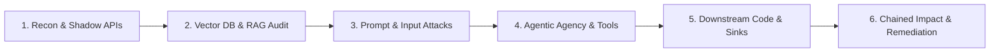

# AI Security Audit & Red-Team Engine

> **Operational Axiom**: Reflection and confabulation are not vulnerabilities. An AI model that merely echoes a payload or outputs synthetic prose has not been breached; an AI system that **executes an unprivileged action**, **leaks verifiable cross-tenant data**, **discloses token-for-token system prompts anchored to unknown secrets**, **triggers out-of-band network callbacks**, or **compromises downstream sinks (SQL, shell, DOM, APIs)** is vulnerable. Every candidate finding must be confirmed through source evidence, empirical verification gates, and chained impact.

---

## 0. Quick-Kill Checklist (Eliminate False Positives First)

Before registering or escalating a finding, apply the strict dismissal criteria:

1. **Model Confabulation / Hallucinated Leaks**: The model claims to disclose a system prompt or another user's conversation, but the text changes across two independent sessions. Discard immediately (*Run-Twice Rule violation*).
2. **Refusal ≠ Secure, Compliance ≠ Vulnerable**: A model refusing a prompt is prompt-layer behavior, not an enforced trust boundary. A model answering "I will act as an admin" with no privileged tool execution, data retrieval, or state mutation is conversational theater, not an exploit.
3. **Prompt Injection Without Impact**: A direct instruction override occurs, but it reads, writes, or modifies nothing outside the current user's authorized session. Mark **Informational**; do not escalate unless chained to tool misuse, privilege escalation, or cross-tenant leakage.
4. **Unexecuted Downstream Payloads**: The model outputs `` or SQL syntax, but the consuming web UI or database layer properly escapes/parameterizes it before execution. Verify the actual sink, not the raw completion.
5. **Simulated Exfiltration Without Egress**: A markdown image (``) is generated, but the client application, CSP, or proxy blocks the outbound request. Require verified out-of-band (OOB) HTTP/DNS callback receipt.

---

## 1. Operating Modes

- **Guidance Mode (Default)**: For architectural threat modeling, targeted code review, single-vulnerability triage, or answering AI security questions. Focuses on code analysis, threat taxonomy mapping, and safe test plans without generating full audit run artifacts.
- **Full Audit Mode**: Triggered when the user requests an end-to-end security review, comprehensive penetration test of an AI system, or formal audit deliverables. Runs the complete 6-Phase Pipeline and generates structured audit reports and findings ledgers.

---

## 2. Universal Execution Safety & Sandboxing

1. **Read-Only Source Review**: Initial source code analysis is non-destructive and read-only.
2. **Local Isolation for Active Verification**: Never target production tenants, live user accounts, or shared enterprise models. Use sandboxed local environments, mock API providers, or isolated loopback test namespaces.
3. **No Credential Harvesting**: Tests must use synthetic test principals, dummy documents, and canary tokens (`CANARY_AI_SEC_<hash>`).
4. **Restricted Egress**: Active OOB validation must use controlled, logged listeners (e.g., dedicated interactsh, Burp Collaborator, or local webhooks) solely to prove data transit.

---

## 3. The 6-Phase Audit Pipeline

### Phase 1: Reconnaissance & Shadow AI API Inventory
*Targeting OWASP API9 (Improper Inventory Management) & Zombie AI Services.*

- **Version Surface Enumeration**:
  - Scan for unlinked paths: `/api/v1/chat`, `/api/v2/chat`, `/api/beta/generate`, `/api/legacy/completion`.
  - Check versioning headers: `X-API-Version`, `Accept: application/vnd.company.v1+json`.
  - Probe subdomain routing: `api-v1.target.com`, `ai-staging.target.com`, `internal-llm.target.com`.
- **OpenAPI / Swagger Spec Diffing**:
  - Fetch active specs (`openapi.json`, `swagger.json`, `api-docs.json`, `.well-known/openapi.json`) and compare against Wayback Machine archived specs.
  - Extract endpoints present in older specifications that still return `200`, `401`, or `403` instead of `404`.
- **Behavioral Security Regression Analysis**:
  - Compare security enforcement between legacy and current routes:
    - *Auth Downgrade*: Does an old `/v1/` endpoint accept expired or missing JWT tokens?
    - *Rate-Limiting Regression*: Is rate-limiting missing on deprecated versions?
    - *Safety Filter Bypass*: Were newer safety prompts, input guardrails, or model content moderation only applied to the `/v2/` frontend while `/v1/` hits raw, unmoderated foundational models?

### Phase 2: Vector Store & RAG Pipeline Hardening
*Targeting OWASP LLM08 (Vector and Embedding Weaknesses) & Multi-Tenant IDOR.*

- **Direct Vector Store Exposure**:
  - Probe unauthenticated default ports:
    - Chroma: `:8000/api/v1/heartbeat`, `:8000/api/v1/collections`
    - Qdrant: `:6333/collections`, `:6333/dashboard`
    - Weaviate: `:8080/v1/schema`, `:8080/v1/graphql`
    - Milvus: `:19530`
    - Managed pgvector: Exposed PostgreSQL instances with vector extension enabled.
- **Cross-Tenant Vector Isolation (Vector IDOR)**:
  - Verify whether multi-tenant scoping is enforced at the database layer (isolated collections, cryptographically bound namespaces) or solely in application-level metadata filtering.
  - Test parameter tampering on retrieval APIs: `{"query": "...", "namespace": "victim-tenant"}` or `{"filter": {"tenant_id": {"$ne": "my_tenant"}}}`.
- **Persistent Corpus Poisoning**:
  - Ingest documents with adversarial payloads crafted to sit near broad query clusters (embedding surface maximization).
  - Verify whether poisoned documents survive vector ingestion and are retrieved by a **different, clean user session** on unrelated semantic queries.
- **Chunk Metadata & Source Text Leakage**:
  - Audit `/api/search` or chat response objects. Verify if internal file paths, raw document chunks, tenant IDs, author metadata, or unredacted PII are exposed in the JSON response payload.

### Phase 3: Adversarial Input & Injection Testing
*Targeting OWASP LLM01:2025 (Prompt Injection) & ASI01 (Goal Hijack).*

- **Direct Prompt Injection**:
  - Test contextual escaping: Delimiter injection (`</system>`, `[INST]`, `"""`), JSON-context breaks (`"role":"system"`), and instruction overrides.
- **Indirect Prompt Injection**:
  - Embed payloads within untrusted data ingestion channels: uploaded PDF/DOCX documents (hidden metadata, white-on-white text, micro-fonts), fetched external URLs, calendar invites, and customer support tickets.
- **Multimodal & Vision Injection**:
  - Test OCR and vision embeddings using image-embedded instruction text, metadata/EXIF payloads, and low-contrast steganographic prompts.
- **Token Smuggling & Obfuscation**:
  - Test non-Latin script smuggling, leetspeak, ROT13/Base64 encoding, and invisible zero-width unicode characters (Tags Block `U+E0000`–`U+E007F`, sneaky bits `U+2062`/`U+2064`) to bypass syntactic keyword guardrails.

### Phase 4: Agentic Tool Bounds & Privilege Verification
*Targeting OWASP ASI02 (Tool Misuse), ASI03 (Privilege Compromise), & ASI08 (Excessive Agency).*

- **Confused Deputy & Excessive Agency**:
  - Evaluate the agent's effective identity when executing tools. Does the agent execute tools using its own high-privilege service account (e.g., admin DB connection, wide AWS IAM role) without re-checking the calling user's permissions on the target resource?
- **Tool-Argument Injection**:
  - Test whether model-generated tool arguments flow into sensitive sinks without handler-side validation:
    - *Browse / Fetch Tool* → SSRF against Cloud Metadata (`http://169.254.169.254/latest/meta-data/`) or internal RFC1918 services.
    - *Bash / Code Interpreter Tool* → Command injection, container escape, host filesystem traversal.
    - *Database Query Tool* → SQL injection or unrestricted table dumps.
- **Action-Binding & Human-in-the-Loop (HITL)**:
  - Check whether destructive or financial operations (sending funds, modifying user permissions, deleting databases, sending bulk emails) require deterministic user confirmation cryptographically bound to the specific normalized action and arguments.
- **MCP (Model Context Protocol) Trust Boundaries**:
  - Verify MCP client-server trust boundaries: Can a malicious MCP server override client tools, spoof system prompts, or poison multi-agent conversation history?

### Phase 5: Downstream Sink & Source-Level Audit
*Targeting OWASP LLM02 (Insecure Output Handling) & Traditional Application Boundaries.*

- **Whitebox Source-First Taint Tracing**:
  - Trace untrusted inputs from model completion handlers into application sinks:
    - *DOM / HTML Sinks*: Does the web frontend render AI markdown using `dangerouslySetInnerHTML` or unescaped HTML parsers without DOMPurify? (AI-generated Stored XSS).
    - *System Execution Sinks*: Does backend code pass model completions into `eval()`, `exec()`, `subprocess.Popen(..., shell=True)`?
    - *Data Persistence Sinks*: Are model summaries stored directly in databases without sanitization, leading to second-order injection?
- **Guardrail Architecture Evaluation**:
  - Verify that guardrails are implemented **outside and downstream of the model** using deterministic code (Pydantic schemas, strict regex validators, output filters), rather than relying on prompt-based self-policing ("Please do not output harmful code").

### Phase 6: Chained Impact Triage & Remediation
*Transforming Informational Findings into Verified Security Fixes.*

- **Chain-to-Impact Matrix**:

| Standalone Signal | Chained Vulnerability | Verified Impact Level |
|---|---|---|
| Prompt Injection | + Reads foreign user conversation / records via IDOR | **High / Critical** |
| Indirect Injection | + Persists in shared vector DB → executes in other users' sessions | **Critical** |
| Tool Misuse (`fetch_url`) | + Hits AWS/GCP IMDS or internal microservices → returns credentials | **Critical (SSRF)** |
| Insecure Output | + Host UI renders raw script → browser session theft | **High (Stored XSS)** |
| System Prompt Leak | + Leaks hardcoded API keys, JWT secrets, or internal hostnames | **High** |
| Shadow API (`/v1/chat`) | + Missing authentication or legacy model without content filters | **High** |

- **Remediation Standard**: Provide the smallest effective, source-level defensive fix (see `references/06-code-level-remediation-patterns.md`).

---

## 4. Canonical Taxonomy Mapping (OWASP LLM 2025 & Agentic ASI 2026)

| Unified ID | Standard Reference | Vulnerability Class | Core Audit Focus |
|---|---|---|---|
| **AIS-01** | OWASP LLM01:2025 | Prompt Injection | Direct instruction overrides, role-delimiter breaks, multimodal prompts. |
| **AIS-02** | OWASP LLM02:2025 | Insecure Output Handling | Downstream XSS, SQLi, shell execution of model-generated text. |
| **AIS-03** | OWASP LLM07:2025 | System Prompt Leakage | Token-for-token extraction anchored to non-guessable internal secrets. |
| **AIS-04** | OWASP LLM08:2025 | Vector & Embedding Weaknesses | Unauthenticated vector DBs, cross-tenant vector IDOR, corpus poisoning. |
| **AIS-05** | OWASP ASI01:2026 | Agentic Goal Hijack | Subversion of autonomous agent workflow logic via untrusted input. |
| **AIS-06** | OWASP ASI02:2026 | Agent Tool Misuse | Model argument coercion leading to SSRF, file access, or command execution. |
| **AIS-07** | OWASP ASI03:2026 | Privilege Compromise | Agent acting as confused deputy with broader privileges than caller. |
| **AIS-08** | OWASP ASI06:2026 | Memory & Context Poisoning | Cross-session memory corruption, persistent state manipulation. |
| **AIS-09** | OWASP ASI08:2026 | Excessive Agency | Autonomous execution of high-impact/destructive actions without HITL. |
| **AIS-10** | OWASP API9:2023 | Shadow & Zombie AI APIs | Forgotten `/v1/` routes, deprecated specs, and unhardened legacy AI endpoints. |

---

## 5. False-Positive Elimination Protocol

Every candidate finding must pass four non-negotiable gates:

1. **The Run-Twice Rule (Verbatim Reproducibility)**:
   - Execute the identical prompt across two fresh, independent sessions with zero shared state.
   - Real prompt leaks and configuration disclosures reproduce token-for-token. If the output varies in structure, phrasing, or facts, it is confabulation.
2. **The Known-Secret Anchor**:
   - Extraction claims must accurately expose a specific, non-guessable anchor (e.g., exact internal tool signature, private variable name, or configuration hash verified in code).
3. **Verifiable Cross-Tenant Evidence**:
   - Cross-tenant data leakage claims must produce verified identifiers or artifacts belonging to an external test tenant under tester control. A model inventing synthetic user names is not an IDOR.
4. **Out-of-Band (OOB) Proof of Egress**:
   - Data exfiltration claims via markdown beacons or fetch tools must correlate directly with a timestamped HTTP/DNS interaction recorded on an authorized collaborator listener (`interactsh` / Burp Collaborator).

---

## 6. Audit Artifacts & Deliverables

When operating in **Full Audit Mode**, generate the following structured deliverables:
- `REPORT.md`: Comprehensive executive report following `templates/AUDIT-REPORT-TEMPLATE.md`.
- `findings.json`: Machine-readable vulnerability ledger conforming to `templates/findings-ledger.schema.json`.
- `NEEDS-VALIDATION.md`: Log of candidate signals that could not be locally verified due to missing sandbox or deployment requirements.
- `REMEDIATION.md`: Exact code diffs and architectural fixes for every confirmed finding.

---

## 7. Parallel Multi-Agent Swarm Orchestration (Hunting Waves)

When operating under an agent swarm coordinator or delegating sub-agents (`invoke_subagent` / `swarm`):

- **Wave A: Perimeter & Reconnaissance (`agent_role: perimeter_hunter`)**:
  - Runs `diff-openapi`, probes version drift (`/v1/` vs `/v2/`), audits exposed Swagger/OpenAPI contracts, and identifies unmoderated zombie LLM routes.
- **Wave B: Vector Store & Ingestion Isolation (`agent_role: vector_hunter`)**:
  - Probes vector database ports (`scan_vector_ports.py`), audits multi-tenant namespace scoping, and tests persistent semantic corpus poisoning.
- **Wave C: Codebase & Downstream Sink Taint (`agent_role: sink_auditor`)**:
  - Executes AST static linter (`lint_ai_code.py`), traces model completions into DOM/SQL/shell execution sinks, and validates MCP server manifests (`audit_mcp_server.py`).
- **Wave D: Active Adversarial Verification & Remediation (`agent_role: exploit_verifier`)**:
  - Runs active canary testing (`redteam_runner.py`), verifies Gate 1 (Run-Twice Rule), confirms OOB callbacks (`oob_listener.py`), produces SARIF reports (`export_sarif.py`), and generates minimal effective fixes (`auto_remediate.py`).

---

## 8. Reference Index

- `references/01-owasp-genai-agentic-matrix.md` — Authoritative crosswalk between LLM Top 10 and ASI01-ASI10.
- `references/02-false-positive-elimination-gates.md` — In-depth empirical proof protocols.
- `references/03-rag-and-vector-security-guide.md` — Vector DB probing, multi-tenant isolation, and corpus defense.
- `references/04-shadow-and-zombie-api-discovery.md` — API version enumeration and spec diffing workflows.
- `references/05-source-first-code-audit-playbook.md` — Whitebox code review guide for AI frameworks.
- `references/06-code-level-remediation-patterns.md` — Concrete, defensive implementation snippets.
- `templates/AUDIT-REPORT-TEMPLATE.md` — Industry-standard markdown audit report template.

---

## 9. Bundled Scanner Tools & Test Harnesses

- `tools/scan_vector_ports.py` — Local/network port & unauthenticated endpoint prober for Chroma, Qdrant, Weaviate, Milvus, and pgvector.
- `tools/diff_openapi.py` — OpenAPI/Swagger spec differ to identify zombie routes and test live reachability.
- `tools/oob_listener.py` — Lightweight HTTP callback server for out-of-band egress verification.
- `tools/audit_mcp_server.py` — Model Context Protocol (MCP) server & tool security auditor.
- `tools/lint_ai_code.py` — Static Python AST security linter for LLM codebases.
- `tools/generate_html_report.py` — Interactive dark-mode executive HTML audit report generator.
- `tools/redteam_runner.py` — Active multi-model red-team fuzzer with automated Run-Twice verification.
- `tools/auto_remediate.py` — Automated AI security vulnerability patcher generating unified diffs.
- `tools/export_sarif.py` — OASIS SARIF v2.1.0 exporter for native GitHub Code Scanning.
- `payloads/prompt_injection_canaries.json` — Structured canary injection templates for non-destructive testing.
- `payloads/token_smuggling_unicode.py` — Invisible Unicode tag encoder to test tokenizer bypass boundaries.
- `examples/vulnerable-ai-app/` — Standalone vulnerable FastAPI testbed for sandbox demonstrations.
- `docker-compose.yml` — 1-click multi-container audit lab (Chroma, Qdrant, Vulnerable App, OOB Listener).
