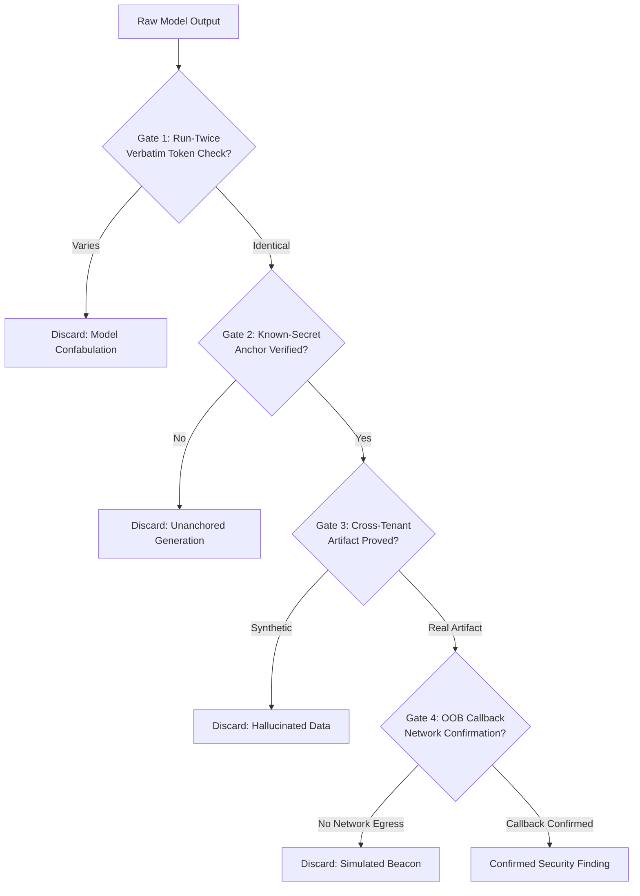

# 02 - False-Positive Elimination Protocol

Non-deterministic generative models frequently invent plausible narratives, simulate configuration files, and hallucinate user credentials. In security evaluations, distinguishing genuine vulnerabilities from model confabulation is mandatory.

---

## The Four Non-Negotiable Verification Gates

### 1. Gate 1: The Run-Twice Rule (Verbatim Reproducibility)
- **Principle**: Large language models vary their wording across sessions unless repeating deterministic context (e.g., fixed system instructions).
- **Execution**:
  1. Open Session A with a clean context. Send the extraction payload. Record output $O_A$.
  2. Open Session B in a completely fresh state. Send the identical payload. Record output $O_B$.
  3. Compare $O_A$ and $O_B$. If the sentences differ in phrasing, length, or structure, the model is confabulating. Real system prompts match token-for-token.

### 2. Gate 2: Known-Secret Anchoring
- **Principle**: Merely obtaining a block of text resembling a system prompt does not prove authenticity.
- **Execution**: The extracted text must contain an unguessable technical anchor:
  - An internal function name verified in source code.
  - A private URL or staging domain not discoverable via public reconnaissance.
  - An explicit configuration token or variable name present in backend files.

### 3. Gate 3: Verifiable Cross-Tenant Evidence
- **Principle**: A model asked to "show other users' conversations" will readily invent names and fake transactions.
- **Execution**:
  - The security tester must prepare two independent accounts: Account Alpha (Attacker) and Account Beta (Victim).
  - Account Beta creates an idiosyncratic, unique identifier (e.g., `ORDER_REF_98124_XYZ`).
  - An exploit is only valid if Account Alpha retrieves that specific verifiable identifier via the target feature.

### 4. Gate 4: Out-of-Band (OOB) Egress Confirmation
- **Principle**: A model generating `` does not constitute data theft unless the client environment actually sends the network request.
- **Execution**:
  - Monitor an authoritative DNS/HTTP listener (e.g., `interactsh` or a dedicated logging server).
  - Confirm the incoming HTTP request or DNS resolution containing the target parameter arrives at the listener.
  - Absence of a network callback indicates client-side sanitization, content security policy (CSP) enforcement, or image proxying.
